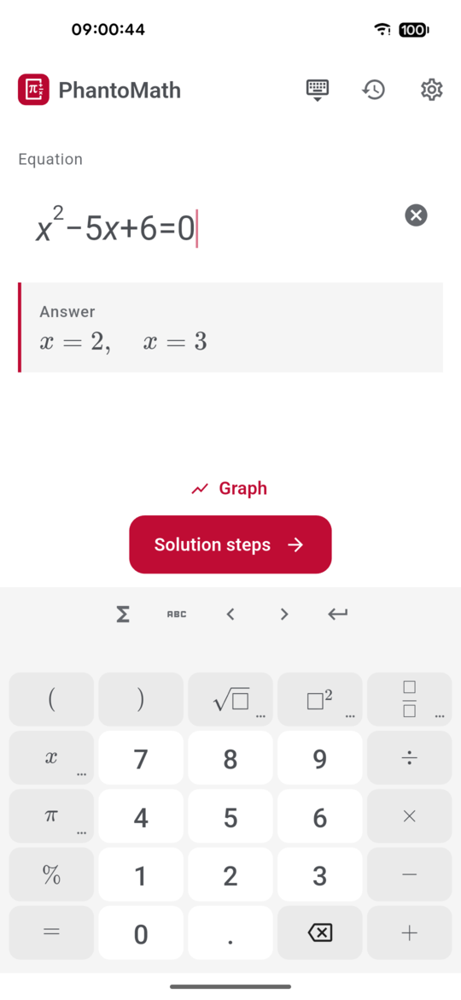
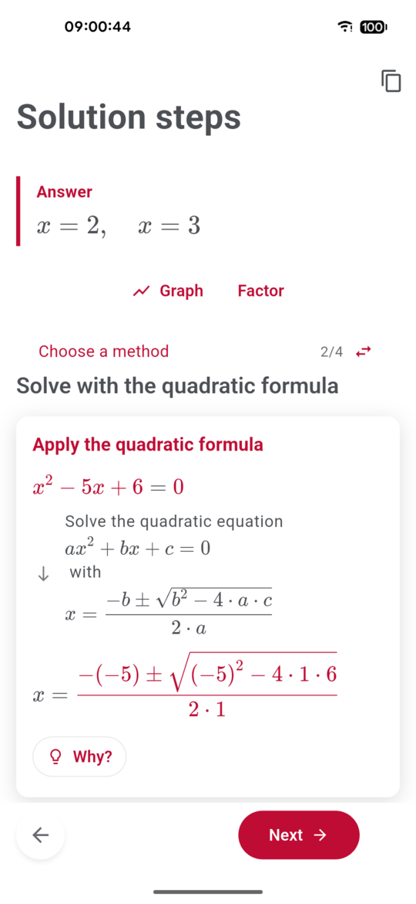
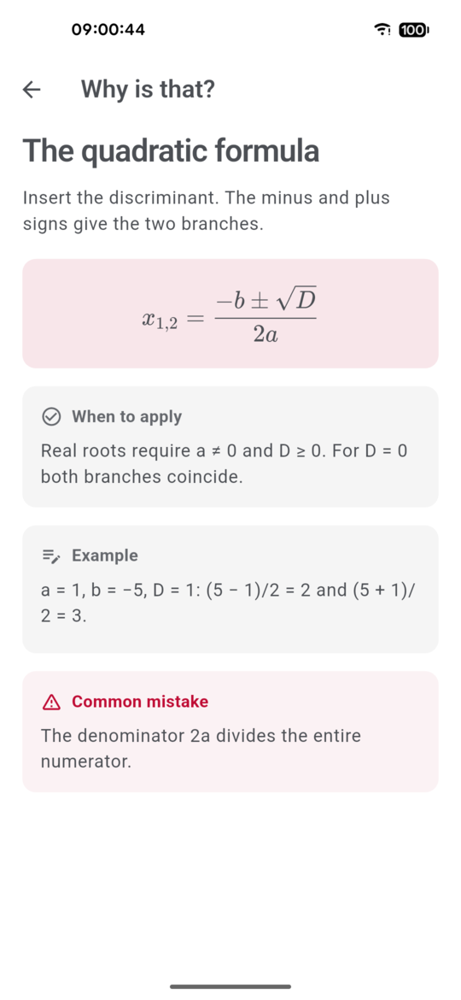
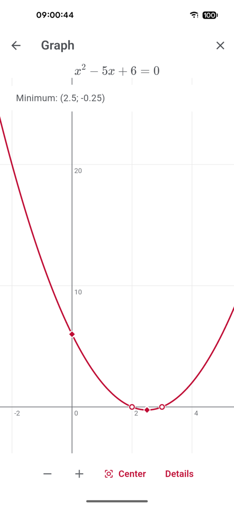

<div align="center">


# PhantoMath

**A maths solver that explains every step — offline, free and open source.**

Type a problem, get the answer as you type, then walk through the solution one step at a time:
what was done, why it is allowed, and what the rule looks like in general.

[](LICENSE)


**English** · [Русский](README.ru.md)

</div>

<p align="center">
  
  
  
  
</p>

## Why PhantoMath

- **Steps you can actually follow.** Each step is a short card: the formula before and after,
  one sentence of explanation and, when you want it, a nested «More detail» screen down to
  the arithmetic.
- **«Why?» on every rule.** Tap it to open a small theory article: the rule, its formula,
  when it applies, a worked example and the typical mistake.
- **Several ways to solve.** A quadratic equation can be solved by factoring, by the formula,
  by completing the square — switch between methods and compare.
- **Answer as you type.** No «Solve» button: the answer appears as soon as the input is complete.
- **Works without internet.** The solver runs on the phone. No account, no ads, no tracking,
  no subscription — your homework never leaves the device.
- **Two languages.** The whole interface and every explanation in English and Russian.
- **Open source.** GPL-3.0. Read how a step is produced, fix it, add a topic.

## What it solves

| Area | Examples |
|---|---|
| Arithmetic | order of operations, fractions, mixed numbers, percentages, column arithmetic, long division |
| Algebra | expand, factor, simplify, powers and roots, logarithms, partial fractions |
| Equations | linear, quadratic, biquadratic, rational, irrational, exponential, logarithmic, absolute value |
| Inequalities | linear, quadratic, rational, with absolute values, exponential and logarithmic |
| Systems | 2×2 and 3×3 linear systems: substitution, elimination, Cramer's rule, Gauss–Jordan, inverse matrix |
| Trigonometry | exact values, identities, trigonometric equations and inequalities, degrees ↔ radians |
| Functions | domain, range, intercepts, parity, extrema, inflection points, asymptotes, inverse function, graphs |
| Calculus | limits (incl. L'Hôpital), derivatives, indefinite / definite / improper integrals, area under a curve |
| Series | finite sums, arithmetic and geometric progressions, convergence tests, radius of convergence |
| Linear algebra | matrix operations, determinants, inverse, rank, matrix equations, vectors |
| More | complex numbers, combinatorics, conic sections, first- and second-order differential equations |

## Install

PhantoMath is an Android app (Android 7.0+).

Build the APK yourself:

```bash
git clone https://github.com/diademoff/PhantoMath.git
cd PhantoMath
make apk
adb install -r app/build/app/outputs/flutter-apk/app-release.apk
```

You need Flutter 3.x, the Android SDK (platform 36), JDK 17+, Python 3.12 and
[uv](https://docs.astral.sh/uv/). `make apk` packs the Python solver together with SymPy into
the APK.

## How it works

```
keyboard ─▶ formula tree ─▶ Python solver on the phone ─▶ steps + explanations ─▶ step screen
```

- **`app/`** — Flutter: a structural formula editor (slots, not text), the maths keyboard, the
  step screen, graphs, notebook and settings.
- **`backend/`** — `mymath_backend`, a Python solver on [SymPy](https://www.sympy.org). One module
  per topic produces the steps; every step names a template from a bilingual dictionary of
  explanations.
- On the phone the solver is embedded with
  [`serious_python`](https://pub.dev/packages/serious_python) and answers on `127.0.0.1` — nothing
  goes over the network.

Details: [docs/ARCHITECTURE.md](docs/ARCHITECTURE.md).

## Development

```bash
cd backend && uv sync --python 3.12 --extra api   # solver + HTTP layer for tests
make backend                                      # solver as a FastAPI server on :8000
make run                                          # the app on a connected device
make test                                         # pytest + flutter test
make lint                                         # ruff, mypy, flutter analyze
```

Over 1800 tests cover the solver and the app; a hand-written corpus pins the expected answer and
the order of steps for each topic, and `tools/fuzz/` checks random problems against SymPy.

Contributions are welcome — see [CONTRIBUTING.md](CONTRIBUTING.md).

## License

[GPL-3.0-or-later](LICENSE). You may use, study, share and change PhantoMath; derived works must
stay open under the same license.
