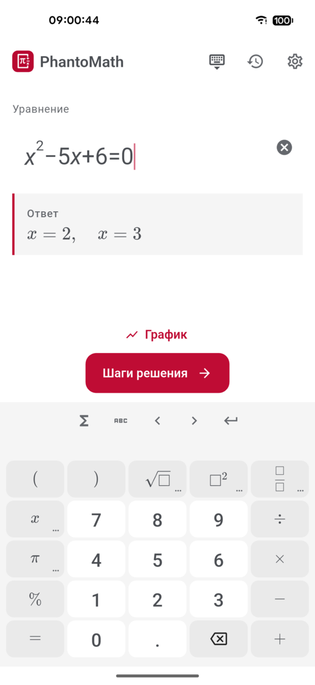
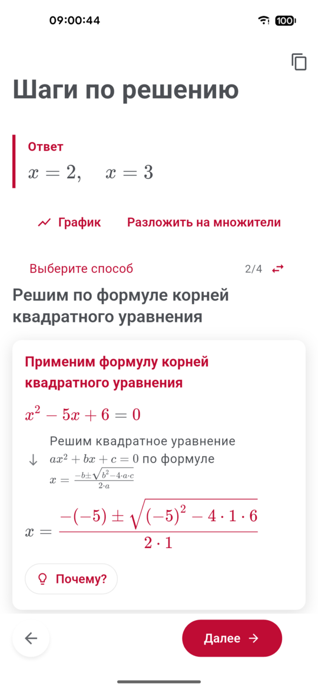
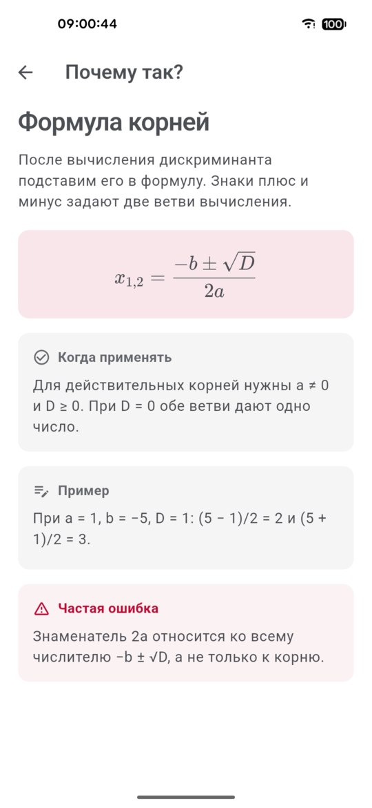
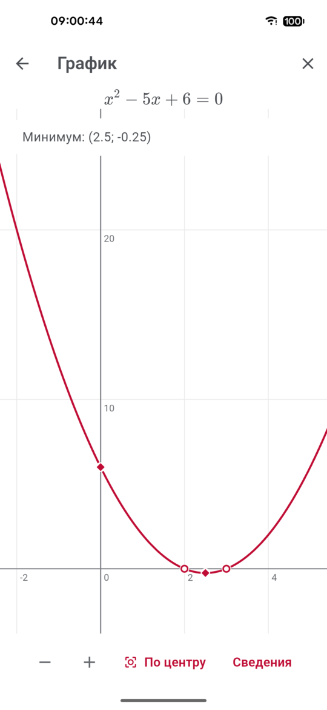

<div align="center">


# PhantoMath

**Решатель задач по математике, который объясняет каждый шаг. Без интернета, бесплатно, с открытым кодом.**

Наберите задачу — ответ появится прямо во время ввода. Потом пройдите решение по шагам:
что сделали, почему так можно и как выглядит правило в общем виде.

[](LICENSE)


[English](README.md) · **Русский**

</div>

<p align="center">
  
  
  
  
</p>

## Почему PhantoMath

- **Шаги, за которыми можно уследить.** Каждый шаг — короткая карточка: формула до и после,
  одно предложение пояснения и, если нужно, вложенный экран «Подробнее» вплоть до арифметики.
- **«Почему?» у каждого правила.** Короткая статья: правило, формула, когда применимо,
  разобранный пример и типичная ошибка.
- **Несколько способов решения.** Квадратное уравнение — разложением на множители, по формуле
  корней, выделением полного квадрата. Переключайтесь и сравнивайте.
- **Ответ во время ввода.** Кнопка «Решить» не нужна: ответ появляется, как только запись закончена.
- **Работает без интернета.** Решатель живёт в телефоне. Ни аккаунта, ни рекламы, ни слежки,
  ни подписки — домашнее задание не покидает устройство.
- **Два языка.** Весь интерфейс и все пояснения — на русском и английском.
- **Открытый код.** GPL-3.0. Посмотрите, как строится шаг, исправьте его, добавьте тему.

## Что решает

| Раздел | Примеры |
|---|---|
| Арифметика | порядок действий, дроби, смешанные числа, проценты, вычисления столбиком, деление уголком |
| Алгебра | раскрыть скобки, разложить на множители, упростить, степени и корни, логарифмы, простейшие дроби |
| Уравнения | линейные, квадратные, биквадратные, дробно-рациональные, иррациональные, показательные, логарифмические, с модулем |
| Неравенства | линейные, квадратные, дробно-рациональные, с модулем, показательные и логарифмические |
| Системы | линейные 2×2 и 3×3: подстановка, сложение, Крамер, Гаусс — Жордан, обратная матрица |
| Тригонометрия | табличные значения, тождества, тригонометрические уравнения и неравенства, градусы ↔ радианы |
| Функции | область определения и значений, нули, чётность, экстремумы, перегибы, асимптоты, обратная функция, графики |
| Анализ | пределы (в т. ч. Лопиталь), производные, неопределённые, определённые и несобственные интегралы, площадь под кривой |
| Ряды | конечные суммы, арифметическая и геометрическая прогрессии, признаки сходимости, радиус сходимости |
| Линейная алгебра | действия с матрицами, определители, обратная матрица, ранг, матричные уравнения, векторы |
| И ещё | комплексные числа, комбинаторика, кривые второго порядка, дифференциальные уравнения 1-го и 2-го порядка |

## Установка

PhantoMath — приложение для Android (7.0 и новее).

Соберите APK сами:

```bash
git clone https://github.com/diademoff/PhantoMath.git
cd PhantoMath
make apk
adb install -r app/build/app/outputs/flutter-apk/app-release.apk
```

Нужны Flutter 3.x, Android SDK (platform 36), JDK 17+, Python 3.12 и
[uv](https://docs.astral.sh/uv/). `make apk` упаковывает Python-решатель вместе с SymPy прямо в APK.

## Как это устроено

```
клавиатура ─▶ дерево формулы ─▶ Python-решатель в телефоне ─▶ шаги + пояснения ─▶ экран решения
```

- **`app/`** — Flutter: структурный редактор формул (слоты, а не текст), математическая
  клавиатура, экран шагов, графики, блокнот и настройки.
- **`backend/`** — `mymath_backend`, решатель на Python и [SymPy](https://www.sympy.org). По модулю
  на тему; каждый шаг ссылается на шаблон из двуязычного словаря пояснений.
- В телефоне решатель встроен через [`serious_python`](https://pub.dev/packages/serious_python)
  и отвечает на `127.0.0.1` — в сеть ничего не уходит.

Подробнее: [docs/ARCHITECTURE.md](docs/ARCHITECTURE.md) (на английском).

## Разработка

```bash
cd backend && uv sync --python 3.12 --extra api   # решатель + HTTP-слой для тестов
make backend                                      # решатель как FastAPI-сервер на :8000
make run                                          # приложение на подключённом устройстве
make test                                         # pytest + flutter test
make lint                                         # ruff, mypy, flutter analyze
```

Больше 1800 тестов покрывают решатель и приложение; вручную составленный корпус фиксирует
ответ и порядок шагов по каждой теме, а `tools/fuzz/` сверяет случайные задачи с SymPy.

Помощь приветствуется — см. [CONTRIBUTING.md](CONTRIBUTING.md).

## Лицензия

[GPL-3.0-or-later](LICENSE). PhantoMath можно использовать, изучать, распространять и изменять;
производные работы должны оставаться открытыми под той же лицензией.
